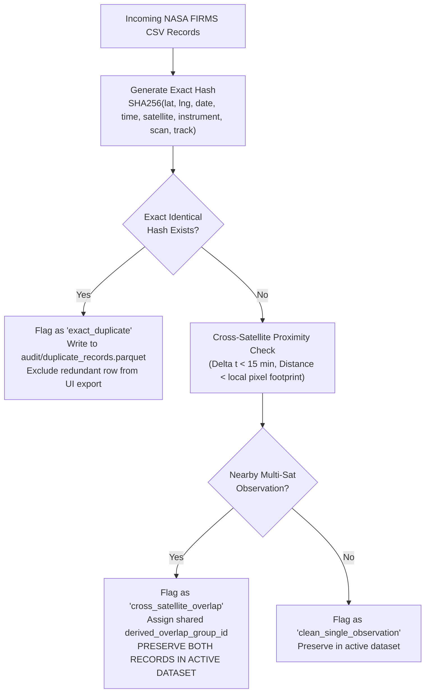

# FireTrace – Data Integration Architecture Specification

**Version:** 2.1 (Final Architectural Revision)  
**Status:** Approved for Pilot Testing (No pipeline code implemented yet)  
**Focus:** Scientific Ingestion, Preservation, Validation & Delivery of NASA FIRMS Observations

---

## 1. Scientific Principles & Requirements

1. **Zero Data Distortion**: Original NASA FIRMS instrument measurements must remain unmodified in storage.
2. **Confidence Preservation & Separation**:
   * The original NASA column `confidence` must be explicitly preserved as `confidence_raw` as delivered in the source file.
   * Sensor-specific fields `modis_confidence` ($0–100\%$) and `viirs_confidence` (`'l'`, `'n'`, `'h'`) must be kept completely separate. They must **never** be conflated or mapped to each other using arbitrary percentage thresholds.
3. **Cross-Satellite Observation Independence**: Multi-satellite detections (e.g., Suomi-NPP vs. NOAA-20, or Terra vs. Aqua) observing the same fire event are separate physical measurements. They must **never** be treated as confirmed duplicates or dropped. Possible overlaps are flagged for review, while exact identical row duplicates from the same satellite/granule are logged in an audit table.
4. **Separation of Raw vs. Derived Attributes**: Original NASA columns are strictly preserved in their original schema, and all derived fields (geocoded place, timestamps, flags) are isolated in a separate `derived_*` namespace.
5. **Rigorous Observation Coverage Classification**: Missing rows in FIRMS CSVs must never be assumed to represent zero detections. Statuses like `valid_zero` or `cloud_obscured` require verified orbital swath coverage geometry and cloud mask quality data. In the absence of validated coverage and cloud data, observation status must be explicitly recorded as `coverage_unknown`.
6. **Pixel Dimensions (`scan` and `track`)**: Preserve original `scan` and `track` float values exactly as computed by NASA without assuming fixed kilometer values or hardcoding nadir/swath-edge examples as universal.
7. **Robust Missing Value Taxonomy**: Distinguish between genuinely corrupt records (rejected to quarantine) and valid records with optional missing fields (preserved with nulls).
8. **Dynamic Pilot Study Boundary**: The initial bounding box for the Palisades pilot dataset is a preliminary search window that must be verified against the actual spatial extent of records in the dataset before fixing the study boundary.
9. **Lightweight Architecture**: Python preprocessing, columnar Parquet master storage, and pre-computed static JSON exports for the React dashboard.

---

## 2. Source Datasets & NASA FIRMS Schema

### 2.1 NASA MODIS Active Fire Product (Collection 6.1 / MCD14DL)
* **`latitude`** (`float64`): Center latitude of the fire pixel ($-90.0$ to $90.0^\circ$).
* **`longitude`** (`float64`): Center longitude of the fire pixel ($-180.0$ to $180.0^\circ$).
* **`brightness`** (`float64`): Channel 21/22 brightness temperature in Kelvin.
* **`scan`** (`float64`): Pixel dimension in the along-scan direction in kilometers as computed by NASA algorithms (varies across the swath; preserved exactly as reported).
* **`track`** (`float64`): Pixel dimension in the along-track direction in kilometers as computed by NASA algorithms (varies across the swath; preserved exactly as reported).
* **`acq_date`** (`string`): Acquisition date (`YYYY-MM-DD`).
* **`acq_time`** (`string`): Acquisition time in UTC military format (`HHMM`).
* **`satellite`** (`string`): Satellite platform (`'Terra'` or `'Aqua'`).
* **`instrument`** (`string`): Sensor name (`'MODIS'`).
* **`confidence`** (`string` / `int`): Raw value preserved as `confidence_raw`. Mapped to `modis_confidence` (`int32`, $0$ to $100\%$).
* **`version`** (`string`): Processing collection and version (e.g., `'6.1NRT'` or `'6.1'`).
* **`bright_t31`** (`float64`, nullable): Channel 31 brightness temperature in Kelvin.
* **`frp`** (`float64`): Fire Radiative Power in Megawatts ($\text{MW}$).
* **`daynight`** (`string`): Solar period (`'D'` for Day, `'N'` for Night).
* **`type`** (`int32`, nullable): Inferred fire source (0 = presumed vegetation, 1 = active volcano, 2 = static land source, 3 = offshore).

### 2.2 NASA VIIRS 375m Active Fire Product (VNP14IMGTDL / VJ114IMGTDL / VJ214IMGTDL)
* **`latitude`** (`float64`): Center latitude of the fire pixel ($-90.0$ to $90.0^\circ$).
* **`longitude`** (`float64`): Center longitude of the fire pixel ($-180.0$ to $180.0^\circ$).
* **`bright_ti4`** (`float64`): Band I-4 brightness temperature in Kelvin.
* **`scan`** (`float64`): Pixel dimension in the along-scan direction in kilometers as computed by NASA algorithms (preserved exactly as reported).
* **`track`** (`float64`): Pixel dimension in the along-track direction in kilometers as computed by NASA algorithms (preserved exactly as reported).
* **`acq_date`** (`string`): Acquisition date (`YYYY-MM-DD`).
* **`acq_time`** (`string`): Acquisition time in UTC military format (`HHMM`).
* **`satellite`** (`string`): Satellite platform (`'N'` for Suomi-NPP, `'1'`/`'20'` for NOAA-20, `'2'`/`'21'` for NOAA-21).
* **`instrument`** (`string`): Sensor name (`'VIIRS'`).
* **`confidence`** (`string`): Raw value preserved as `confidence_raw`. Mapped to `viirs_confidence` (`string`: `'l'` = low, `'n'` = nominal, `'h'` = high).
* **`version`** (`string`): Processing version (e.g., `'2.0NRT'`, `'1.0'`).
* **`bright_ti5`** (`float64`, nullable): Band I-5 brightness temperature in Kelvin.
* **`frp`** (`float64`): Fire Radiative Power in Megawatts ($\text{MW}$).
* **`daynight`** (`string`): Solar period (`'D'` for Day, `'N'` for Night).
* **`type`** (`int32`, nullable): Fire source flag (0 = vegetation, 1 = volcano, 2 = static, 3 = offshore).

---

## 3. Unified Storage Schema with Namespace Separation

```
+------------------------------------------------------------------------------+
|                          MASTER PARQUET RECORD                               |
+------------------------------------------------------------------------------+
| RAW NASA COLUMNS (Unmodified, exactly as delivered by NASA FIRMS):           |
|   latitude          : float64                                                |
|   longitude         : float64                                                |
|   scan              : float32  (Ground pixel along-scan dimension in km)     |
|   track             : float32  (Ground pixel along-track dimension in km)    |
|   acq_date          : string   ("YYYY-MM-DD")                                |
|   acq_time          : string   ("HHMM")                                      |
|   satellite         : string   ("Terra"|"Aqua"|"N"|"1"|"2"|"20"|"21")        |
|   instrument        : string   ("MODIS"|"VIIRS")                             |
|   confidence_raw    : string   (Literal raw value from NASA "confidence")    |
|   version           : string                                                 |
|   frp               : float32  (Fire Radiative Power in MW)                  |
|   daynight          : string   ("D"|"N")                                     |
|   type              : int16?   (Nullable)                                    |
|                                                                              |
| SENSOR-SPECIFIC TYPED COLUMNS (Strictly separate, no forced conversions):    |
|   modis_brightness  : float32? (MODIS Channel 21/22 Kelvin, null for VIIRS)  |
|   modis_bright_t31  : float32? (MODIS Channel 31 Kelvin, null for VIIRS)     |
|   modis_confidence  : int16?   (MODIS integer percentage 0-100, null for VIIRS)|
|   viirs_bright_ti4  : float32? (VIIRS Band I-4 Kelvin, null for MODIS)       |
|   viirs_bright_ti5  : float32? (VIIRS Band I-5 Kelvin, null for MODIS)       |
|   viirs_confidence  : string?  (VIIRS discrete category "l"|"n"|"h", null)  |
|                                                                              |
| DERIVED FIELDS (Clearly separated namespace for frontend & analytics):       |
|   derived_record_id             : string   (Deterministic UUID from raw keys)|
|   derived_timestamp_utc         : string   (ISO-8601: "YYYY-MM-DDTHH:MM:00Z")|
|   derived_sensor_canonical      : string   ("MODIS Terra" | "VIIRS NOAA-20") |
|   derived_family                : string   ("MODIS" | "VIIRS")               |
|   derived_period                : string   ("Day" | "Night")                 |
|   derived_place                 : string   (Geocoded administrative name)    |
|   derived_region_key            : string   ("california" | "pnw" | "west_us")|
|   derived_is_exact_duplicate    : bool     (Identical row duplicate flag)    |
|   derived_cross_sat_overlap     : bool     (Coincident swath overlap flag)   |
|   derived_overlap_group_id      : string?  (Group ID for multi-sat analysis) |
+------------------------------------------------------------------------------+
```

---

## 4. Confidence Representation Strategy

1. **Preservation of `confidence_raw`**:
   The exact literal value from the NASA `confidence` column is stored as `confidence_raw`.
2. **No Arbitrary Conversion**:
   * MODIS values are typed as integers ($0–100\%$) in `modis_confidence`.
   * VIIRS values are typed as characters (`'l'`, `'n'`, `'h'`) in `viirs_confidence`.
   * The pipeline will **never** assign percentage values to VIIRS or label tiers to MODIS.
3. **UI Filtering & Presentation**:
   * The detail panel displays the true native metric based on sensor family:
     * MODIS: `Confidence: 78%`
     * VIIRS: `Confidence: Nominal (Class: 'n')` or `Confidence: High (Class: 'h')`
   * Fire Explorer filters provide separate controls: a continuous slider ($0–100\%$) for MODIS and a discrete toggle (`All`, `Nominal & High`, `High only`) for VIIRS.

---

## 5. Safe Deduplication & Cross-Satellite Overlap Audit



### 5.1 Exact Identical Duplicates (Single-Satellite Redundancy)
* Generated when the exact same swath granule is processed twice or overlapping tile boundaries repeat identical rows.
* Match key: exact unrounded coordinates, date, time, satellite, instrument, scan, and track.
* Handled by writing the duplicate record to `audit/duplicate_records.parquet` with ingest metadata.

### 5.2 Cross-Satellite Detections (Multi-Platform Overpasses)
* When Suomi-NPP and NOAA-20 (or Terra and Aqua) pass over the same fire within minutes of each other, they are **independent scientific observations** with different viewing geometries and pixel sizes.
* **Rule**: Cross-satellite detections are **NEVER treated as duplicates** and are **NEVER dropped**.
* They are preserved as distinct rows, flagged with `derived_cross_sat_overlap = true`, and linked via `derived_overlap_group_id` for scientific review.

---

## 6. Overpass Coverage & Observation Quality

```
                          Observation Quality Tree
                                     │
                 ┌───────────────────┴───────────────────┐
                 ▼                                       ▼
     SWATH & QUALITY DATA AVAILABLE            NO SWATH / QUALITY DATA
     ──────────────────────────────            ───────────────────────
     • Verified Overpass + Fire Detected       • FIRMS row absent and no
       -> Status: "detected"                     verified swath/cloud data
     • Verified Overpass + Clear Sky + 0 Fire    -> Status: "coverage_unknown"
       -> Status: "valid_zero"
     • Verified Overpass + Obscured Cloud
       -> Status: "cloud_obscured"
```

1. **FIRMS Absence $\neq$ Zero Fire Activity**:
   * If a FIRMS CSV has no rows for a date, the pipeline **must not** record `0 detections` or `valid_zero` without external verification.
2. **Condition for `valid_zero`**:
   * Assigned **only** when satellite swath footprint geometry confirms the sensor passed over the AOI **and** cloud-mask quality data confirms unobscured surface visibility.
3. **Condition for `cloud_obscured`**:
   * Assigned **only** when swath coverage is confirmed but cloud-mask quality flags indicate heavy cloud or smoke obscuration.
4. **Default Status (`coverage_unknown`)**:
   * If orbital swath footprint or cloud mask data is not present in the pipeline, the status remains explicitly **`coverage_unknown`**, preventing scientific misinterpretation.

---

## 7. Quality Taxonomy & Pixel Ground Dimensions

### 7.1 Pixel Ground Footprint (`scan` and `track`)
* Preserved as exact raw floating-point numbers in kilometers ($\text{km}$) as generated by NASA's geolocation algorithms.
* No fixed universal kilometer values or nadir examples are hardcoded.
* Pixel ground footprint interpretation follows official NASA documentation:
  * MODIS: *MODIS Active Fire Product User's Guide (MCD14DL)*
  * VIIRS: *VIIRS 375m Active Fire Algorithm Theoretical Basis Document (VNP14IMGTDL)*

### 7.2 Defect vs. Optional Missing Value Handling
* **Genuinely Corrupt Records (Quarantined)**:
  * Latitude outside $[-90, 90]$ or Longitude outside $[-180, 180]$
  * Malformed or unparseable `acq_date` or `acq_time`
  * $\text{FRP} < 0$ or NaN
  * $\text{scan} \le 0$ or $\text{track} \le 0$
  * Written to `data/quarantine/corrupt_records.parquet` with defect code.
* **Valid Records with Missing Attributes (Accepted)**:
  * Unpopulated `type` attribute (common in NRT products)
  * Missing Channel 31 (`bright_t31`) or Band I-5 (`bright_ti5`)
  * Preserved as nullable SQL/Parquet fields.

---

## 8. Pilot Testing Plan: Palisades Fire Dataset

### 8.1 Preliminary Bounding Box & Boundary Verification Step
* **Preliminary Search Window**:
  * Latitude: $[33.950^\circ\text{N}, 34.150^\circ\text{N}]$
  * Longitude: $[-118.650^\circ\text{W}, -118.450^\circ\text{W}]$
* **Mandatory Spatial Extent Verification Step**:
  * Before fixing the study boundary or running aggregations, the pilot script will compute the actual bounding box of all ingested records:
    $$\text{Actual Box} = [\min(\text{lat}), \max(\text{lat})] \times [\min(\text{lng}), \max(\text{lng})]$$
  * If active fire detections extend beyond the preliminary box, the bounding box will be expanded to encompass the full incident footprint.

### 8.2 Pilot Validation Steps
1. **Schema Check**: Confirm `confidence_raw` matches original CSV text, while `modis_confidence` and `viirs_confidence` maintain distinct types.
2. **Ground Footprint Inspection**: Verify raw `scan` and `track` float values are preserved without rounding.
3. **Cross-Satellite Overlap Audit**: Verify coincident Suomi-NPP and NOAA-20 records are preserved as separate rows with `derived_cross_sat_overlap = true`.
4. **Data Delivery Verification**: Generate `public/data/pilot_palisades.json` for validation on the FireTrace map.

---

## 9. Directory Structure

```
e:\NASA\
├── docs/
│   └── DATA_INTEGRATION_ARCHITECTURE.md    # This specification
├── pipeline/
│   ├── raw/                                # Incoming NASA FIRMS CSV granules
│   │   └── palisades_pilot/                # Pilot dataset
│   ├── boundaries/                         # GeoJSON administrative polygons
│   ├── processed/                          # Cleaned, partitioned Parquet archive
│   ├── audit/                              # Exact duplicates & overlap logs
│   │   ├── duplicate_records.parquet
│   │   └── cross_satellite_overlaps.parquet
│   ├── quarantine/                         # Fatal defects log
│   │   └── corrupt_records.parquet
│   ├── scripts/                            # Python ingestion & validation CLI
│   │   ├── ingest_firms.py                 # Core CSV -> Parquet ingest
│   │   ├── validate_spatial_extent.py      # Bounding box verification
│   │   └── export_dashboard_json.py        # Static JSON generation
│   └── tests/
├── public/
│   └── data/                               # Static JSON exports for React dashboard
└── src/                                    # React 19 Frontend (Unchanged)
```
